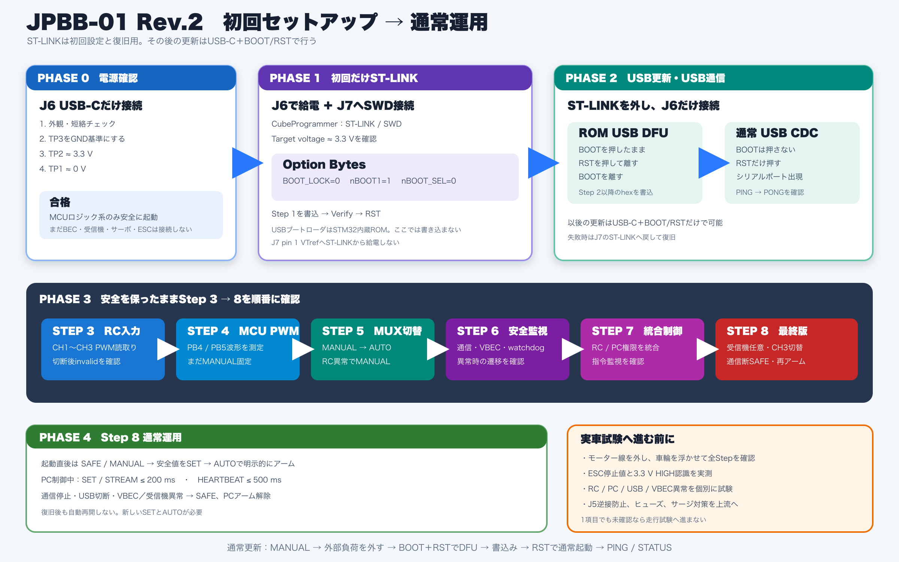

# JPBB-01 Rev.2 セットアップ手順

この手順は、未設定の基板を受け取ってから、ST-LINKによる初回設定、
USB DFU更新、USB CDC通信、受信機・サーボ・ESCを使った段階試験を経て、
Step 8の通常運用へ移るまでの推奨順序です。



詳細な配線、ビルドコマンド、STM32CubeProgrammerの画面操作は
[`firmware/GETTING_STARTED.md`](../firmware/GETTING_STARTED.md)を参照してください。

## 最初に理解する2種類のUSB認識

| モード | 入り方 | 用途 | PC側で見えるもの |
| --- | --- | --- | --- |
| ROM USB DFU | BOOTを押したままRSTを押して離し、その後BOOTを離す | ファームウェア書き込み | STM32内蔵DFUデバイス |
| 通常起動 USB CDC | BOOTを押さずRSTだけ押す | コマンド・状態通信 | シリアルポート／Virtual COM Port |

USB DFUのブートローダはSTM32内蔵ROMに最初から存在します。初回ST-LINKでは、
USBブートローダを書き込むのではなく、基板上のBOOTボタンから内蔵ROMを選べるように
Option Bytesを設定します。

## Phase 0 — 無通電検査とUSB単独給電

この段階では受信機、サーボ、ESC、BEC、バッテリーを接続しません。

1. 部品ずれ、はんだブリッジ、C1・D1・D2の向き、USB-CやJ7の損傷を確認する。
2. 無通電でTP3を基準にTP1–GND、TP2–GNDの抵抗を測り、0 Ω付近の短絡がないことを確認する。
3. J6へUSB-Cだけを接続する。
4. TP3を黒プローブにして、TP2が約3.3 V、TP1が0 V付近であることを確認する。
5. 異臭、発煙、局所的な異常発熱があれば直ちにUSBを外す。

合格すると、USBからU1の3.3 Vロジック系だけを安全に起動できている状態です。
USB単独ではVBEC、受信機、U2、サーボ、ESCへは給電されません。

## Phase 1 — 初回だけST-LINKを使用

### 接続

1. J6のUSB-Cから基板を給電する。
2. ST-LINKのSWDケーブルをJ7へ接続する。
3. J7 pin 1のVTrefは基板電圧の参照入力として使い、ST-LINKから3.3 Vや5 Vを供給しない。
4. STM32CubeProgrammerで`ST-LINK`／`SWD`を選び、Target voltageが約3.3 Vであることを確認する。

### Option Bytes

次の3項目だけを設定し、適用後に再接続して読み戻します。

```text
BOOT_LOCK = 0
nBOOT1    = 1
nBOOT_SEL = 0
```

`RDP`、`WRP`、`PCROP`など、他の保護設定は変更しません。

### 最初のファームウェア

1. ST-LINK経由で`step1_safe_boot.hex`を書き込む。
2. Verify成功を確認する。
3. BOOTを押さずRSTだけを押し、通常起動させる。
4. 再度SWD接続できること、異常発熱がないことを確認する。

Step 1には表示LEDもUSB CDCもありません。書き込みVerify、再接続、異常発熱なしが
この段階の主な合格条件です。ここまで完了すれば、ST-LINKの初回必須作業は終了です。

## Phase 2 — USB DFUとUSB CDCを確認

### ROM USB DFUへ入る

1. ST-LINKとJ1〜J5の外部機器を外し、J6のUSB-Cだけを接続する。
2. SW2（BOOT）を押したままにする。
3. SW1（RST）を押して離す。
4. SW2（BOOT）を離す。
5. STM32CubeProgrammerの接続方式を`USB`へ変更し、DFUデバイスを検出する。
6. USB DFU経由で`step2_usb_cdc.hex`を書き込み、Verifyを確認する。

### 通常起動してUSB CDCを確認

1. 書き込み完了後、BOOTを押さずRSTだけを押す。
2. DFUデバイスが消え、シリアルポート／Virtual COM Portが現れることを確認する。
3. シリアルコンソールから`PING`を送り、`PONG`が返ることを確認する。

ここまで合格すれば、以後の通常更新はJ6、BOOT、RSTだけで行えます。
ST-LINKは復旧、デバッグ、Option Bytes再設定のために保管します。

## Phase 3 — Step 3〜8を順番に確認

前のStepが合格してから次へ進みます。Step 5以降は必ずモーター線を外し、
車輪を浮かせ、電源をすぐ切れる状態にします。

| Step | 追加する確認 | 主な接続 | 合格条件 |
| --- | --- | --- | --- |
| 3: RC入力 | 受信機CH1〜CH3のPWM読取り | J1〜J3、J5 BEC、J6 | 操作に応じ1000〜2000 µs程度、切断約100 ms後にinvalid |
| 4: MCU PWM | MCU生成PWM | J6、オシロスコープ | PB4/PB5またはR22/R23で指定パルス幅。MUXはMANUALのまま |
| 5: MANUAL/AUTO | U2による経路切替 | 受信機、J4、J5、J6 | 起動時MANUAL、条件成立時だけAUTO、RC異常でMANUAL |
| 6: フェイルセーフ | VBEC、USB、heartbeat、watchdog | Step 5と同じ | 通信停止・USB切断・VBEC異常で設計どおり安全遷移 |
| 7: 最終制御 | RC／PC制御権と指令監視 | 使用構成一式 | SAFE開始、明示的アーム、タイムアウト時SAFE、再アーム必須 |
| 8: 最終版 | 受信機任意、CH3切替、通信断理由 | 使用構成一式 | 受信機なしPC、CH3 RC/PC切替、通信断ラッチSAFEを確認 |

J1〜J5は`S / + / -`の順です。J5の`+`がVBEC入力です。安定化電源で試す場合は
最初は5.2〜6.0 V、電流制限付きとし、複数のBECや外部電源を同時接続しません。

## Phase 4 — Step 8の通常運用

通常起動は常にBOOTを押さずRSTだけを押します。

1. 起動直後は`SAFE`／MANUAL側から始まる。
2. 受信機を使う場合、CH3が1300 µs以下で安定するとRC操作を優先する。
3. CH3が1700 µs以上で安定するか、受信機が存在しない場合にPC制御を許可できる。
4. PC制御は、まず`SET 1500 1500`などの安全値を送り、その後`AUTO`で明示的にアームする。
5. PC制御中は`SET`または`STREAM`を200 ms以内、`HEARTBEAT`を500 ms以内で更新する。
6. 指令停止、heartbeat停止、USB切断、VBEC異常ではSAFEへ移行し、PCアームを解除する。
7. 通信が復旧しても勝手には再開せず、新しい`SET`と`AUTO`が必要になる。
8. 一度正常検出した受信機が消失した場合もSAFEへ移行し、PC専用構成へ自動移行しない。

受信機のCH1はJ4サーボ、CH2はJ5 ESCへ対応します。MANUALでは受信機信号をU2が
直接通し、PC制御ではU1が生成した3.3 V PWMへ切り替えます。
受信機なし構成へ切り替える場合は、受信機を外した状態で基板を再起動します。

## 2回目以降のファームウェア更新

1. `MANUAL`へ戻す。
2. サーボ、ESC、BEC、受信機を外す。
3. J6のUSB-Cだけを接続する。
4. BOOTを押したままRSTを押して離し、その後BOOTを離す。
5. STM32CubeProgrammerのUSB接続から対象`.hex`を書き込む。
6. BOOTを押さずRSTだけを押して通常起動する。
7. `PING`、`STATUS`、安全値の順に動作確認する。

DFUに入れない、書き込みに失敗する、通常起動しない場合はJ7へST-LINKを戻し、
connect under resetで復旧します。通常更新の失敗時もJ7は復旧経路として残ります。

## 実車接続へ進む前の停止条件

次の項目が1つでも未確認なら、モーターを接続した走行試験へ進みません。

- USB単独時にTP2が約3.3 V、TP1が0 V付近になる。
- USB DFUと通常起動USB CDCの両方を識別できる。
- 受信機PWMのエッジ極性とパルス幅を実機で確認できる。
- 使用するサーボとESCが3.3 V Highを認識する。
- 使用するESCの停止値が現在の1500 µs設定と一致する。
- MANUAL/AUTO切替時に危険なグリッチがない。
- RC喪失、PC指令停止、heartbeat停止、USB切断、VBEC異常を個別に確認できる。
- J5の逆接防止と上流側のヒューズ／過電流／サージ対策を用意できる。

現時点のファームウェア資料では、上記の実機検証は未完了です。各Phaseの結果を記録し、
不一致があれば次へ進まず、そのPhaseで原因を確認してください。
