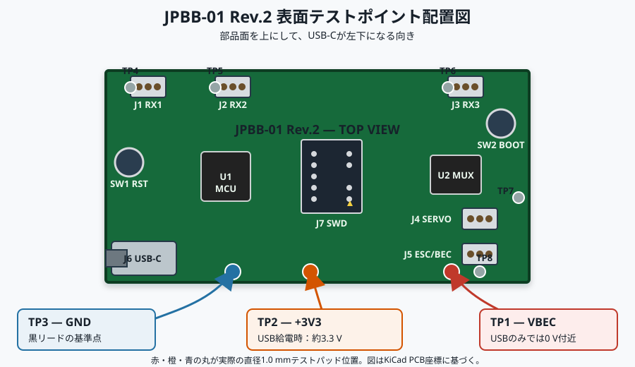

# JPBB-01 Rev.2 初回接続・書き込みガイド

このガイドは、基板へ何も接続していない状態から始めます。最初は
`step1_safe_boot`だけを書き込み、成功してから一つずつ先へ進みます。

> [!CAUTION]
> Step 5以降はサーボやESCが動きます。車両のタイヤを浮かせ、モーター線を
> 外し、バッテリーをすぐ切れる状態にしてください。実機検証が終わるまでは
> 人や物の近くで試さないでください。

## 0. 最初に覚える向き

以下は、部品と白い文字が見える表面を上にし、`RX1/RX2/RX3`が上、
`USB-C`が左下になる向きです。

```text
                 基板の上側
   RX1 (J1)       RX2 (J2)                 RX3 (J3)   BOOT (SW2)
   [ S + - ]      [ S + - ]                [ S + - ]     [●]

             RST (SW1)       SWD (J7)
                [●]            [2列×5段]
                                  △ pin 1

   USB-C (J6)                                  SERVO (J4) [ S + - ]
   基板左下の端                                ESC/BEC(J5) [ S + - ]
                 基板の下側
```

- `S`は信号、`+`はVBEC、`-`はGNDです。
- J1〜J5は、上の向きで見ればすべて左から`S / + / -`です。
- 四角いはんだパッドと小さな三角印が`S`（pin 1）です。
- J6は左下の基板端にあるUSB-Cコネクタです。
- J7は基板中央の小さい2列コネクタです。
- SW1は左側の`RST`ボタン、SW2は右上の`BOOT`ボタンです。



無通電試験では、まず青のTP3をマルチメーターの黒リード基準にします。
TP1〜TP8は直径1.0 mmの小さい裸パッドで、コネクタの穴ではありません。

### J7を真上から見たピン配置

J7の白い枠内を、上記と同じ基板向きで見ます。

```text
                 基板の上側
        左列                    右列
   pin 10  NRST            pin 9   GND
   pin  8  NC              pin 7   穴なし（キー）
   pin  6  NC              pin 5   GND
   pin  4  SWCLK           pin 3   GND
   pin  2  SWDIO           pin 1   VTref (+3V3参照)  ◀ 三角印
                 基板の下側
```

J7のpin 1は、この向きでは**右下**です。10-pinフラットケーブルの赤線を
この右下の三角印側へ合わせます。pin 7の位置には物理的にピンがないので、
キー穴を塞いだ正しいCortex 10-pinソケットは逆向きに入りません。入らない
場合は力を加えず、向きを見直してください。

> [!WARNING]
> J7 pin 1はST-LINKが基板の3.3 Vを読むためのVTrefです。基板へ電源を
> 入れる端子ではありません。基板はJ6のUSB-Cから別に給電します。
> ST-LINKに`3.3 V OUT`や`5 V OUT`のジャンパがある場合は使いません。

## 1. 必要な物

初回のSWD書き込みは、次の接続を想定しています。

```text
Mac
 ├─ USB-Cケーブル ────────────── J6（基板の電源）
 └─ USB-A変換/ハブ ─ ST-LINK
                    └─ 20-pinフラットケーブル
                       └─ ARM20→Cortex10変換基板
                          └─ 10-pin 1.27 mmフラットケーブル ─ J7
```

- 20-pin端子のST-LINK V2互換品
- ARM 20-pin（2.54 mm）からCortex SWD 10-pin（1.27 mm）への変換基板
- 上記に合う20-pinと10-pinのフラットケーブル
- データ通信対応USB-Cケーブル
- 抵抗・直流電圧を測れるデジタルマルチメーター
- MacにUSB-A端子がなければUSB-CハブまたはUSB-C→USB-A変換

J7はPCBA注文どおりなら実装済みなので、上記の変換基板を使えばSWD信号を
1本ずつ手配線する必要はありません。

一方、J1〜J5は製造費を下げるためPCBA非実装（DNP）です。Step 1/2/4には
不要ですが、Step 3とStep 5以降で受信機、サーボ、ESCをつなぐ前に、
2.54 mmピッチ1列3ピンのヘッダーをJ1〜J5へはんだ付けする必要があります。
これはSWD書き込み配線とは別の作業です。

### 1.1 ピンヘッダーを付ける前にできる試験

J1〜J5を未実装のまま、次の順で試験できます。抵抗値と電圧値は基板ごとに
記録し、前の項目が合格してから次へ進みます。

1. 無通電で外観を確認し、はんだブリッジ、部品ずれ、C1/D1/D2の極性異常が
   ないことを確認する。
2. USB、ST-LINKを外したまま、TP3（GND）を基準にTP1（VBEC）と
   TP2（+3V3）の対GND抵抗を測る。測定値が0 Ω付近に張り付く場合は
   通電せず、短絡箇所を調べる。
3. J6へUSB-Cだけを接続する。TP3を黒リードの基準にして、TP2が約3.3 V、
   TP1が0 V付近であることを確認する。異臭、発煙、局所的な異常発熱が
   あれば直ちにUSBを抜く。
4. J6給電とJ7のST-LINKだけでStep 1を書き込み、Verifyと再接続を確認する。
5. Step 2を書き込み、J6だけでUSB CDCの`PING`→`PONG`とエコーを確認する。
6. 初回Option Bytes設定後、BOOTを押したままRSTを押して離し、その後
   BOOTを離して、ROM USB DFUとして認識されることを確認する。
7. オシロスコープを使用できる場合はStep 4を書き込み、R22/R23のMCU側で
   `SET`指令どおりのPB4/PB5 PWMを確認する。プローブを滑らせて隣接パッドを
   短絡しないようにする。

この段階ではVBEC給電、RX1〜RX3入力、MANUAL信号通過、MUX切替、
サーボ／ESC駆動は試験しません。TP1/TP3へ不安定な手持ちプローブで電源を
加えることも避け、これらはJ1〜J5のヘッダー実装後に行います。

## 2. Macへ必要なソフトを入れる

### 2.1 ビルド用ソフト

Homebrewが入っているMacでは次を実行します。

```bash
brew install cmake ninja
brew install --cask gcc-arm-embedded
```

インストール後に確認します。

```bash
cmake --version
ninja --version
arm-none-eabi-gcc --version
```

3つともバージョンが表示されれば準備完了です。Arm GNU Toolchainは
Homebrewを使わず、Arm公式macOS用パッケージから入れても構いません。

### 2.2 書き込み用ソフト

ST公式の
[STM32CubeProgrammer](https://www.st.com/content/st_com/en/stm32cubeprogrammer.html)
macOS版をダウンロードしてインストールします。これはビルドではなく、
完成した`.hex`をST-LINKまたはUSB DFU経由でSTM32へ書くためのアプリです。

## 3. STM32CubeG0を取得する

ターミナルでこのプロジェクトのルートへ移動してから実行します。

```bash
mkdir -p firmware/vendor
git clone --recursive --shallow-submodules --depth 1 --branch v1.6.3 \
  https://github.com/STMicroelectronics/STM32CubeG0.git \
  firmware/vendor/STM32CubeG0
```

`firmware/vendor/`はGit管理対象外です。2回目以降はcloneを繰り返しません。

## 4. Step 1をビルドする

プロジェクトのルートで実行します。

```bash
cmake -S firmware -B firmware/build/step1 -G Ninja \
  -DKART_STEP=step1_safe_boot \
  -DSTM32CUBE_G0_PATH="$PWD/firmware/vendor/STM32CubeG0" \
  -DCMAKE_BUILD_TYPE=Release

cmake --build firmware/build/step1
```

成功すると、書き込みに使うファイルができます。

```text
firmware/build/step1/step1_safe_boot.hex
```

エラー時は、まず`arm-none-eabi-gcc --version`が通るか、STM32CubeG0を
`--recursive`付きで取得したかを確認します。

## 5. 初回の物理接続

この段階では、受信機、サーボ、ESC、BEC、バッテリーをすべて外します。
J6とJ7以外には何も接続しません。

1. Mac、ST-LINK、変換基板、基板の全電源を外した状態にする。
2. 20-pinケーブルの赤線をST-LINK側のpin 1印へ合わせて挿す。
3. 反対側を変換基板のARM 20-pin側へ、赤線をpin 1印に合わせて挿す。
4. 10-pinケーブルを変換基板のCortex/SWD 10-pin側へ挿す。
5. 10-pinケーブルの反対側を基板中央J7へ挿す。赤線はJ7の右下、
   三角印のpin 1側にする。
6. ST-LINKをMacへ接続する。
7. 最後にJ6へUSB-Cケーブルを接続し、Macから基板を給電する。

正しくつながると、J7 pin 1には基板側から約3.3 Vが現れ、ST-LINKはそれを
ターゲット電圧として検出します。J6を抜いた状態でST-LINKだけから基板が
起動する場合は、ST-LINK側から誤給電している可能性があるため中止します。

## 6. STM32CubeProgrammerで初回書き込み

1. STM32CubeProgrammerを起動する。
2. 右側の接続方式で`ST-LINK`を選ぶ。
3. Portは検出されたST-LINK、Protocolは`SWD`を選ぶ。
4. Frequencyは最初は`400 kHz`または`1 MHz`に下げる。
5. Reset modeを選べる場合は`Hardware reset`を選ぶ。
6. `Connect`を押す。
7. Deviceが`STM32G0B1CB...`系、Target voltageが約3.3 Vであることを確認する。

接続できない場合は、すぐに設定変更せず、次を順に確認します。

- J6から基板へ給電しているか
- J7の赤線が右下の三角印側か
- 20-pin側も赤線がpin 1か
- 10-pinコネクタを1列ずらしていないか
- `RST`を押しながら`Connect`し、接続開始後に`RST`を離すと認識するか
- SWD周波数を`100 kHz`まで下げると認識するか

### 6.1 初回だけ設定するOption Bytes

CubeProgrammerの`Option Bytes`画面で、次の3項目だけを確認・変更します。

```text
BOOT_LOCK = 0
nBOOT1    = 1
nBOOT_SEL = 0
```

`nBOOT_SEL`が正しい名前で、`nBOOT0_SEL`ではありません。`RDP`、`WRP`、
`PCROP`など、上記以外の保護設定には触れません。適用後にSTM32がリセット
されて接続が切れたら、再度`Connect`し、3項目を読み戻して確認します。

### 6.2 Step 1のhexを書き込む

1. `Erasing & Programming`画面を開く。
2. File pathへ
   `firmware/build/step1/step1_safe_boot.hex`を選ぶ。
3. `Verify programming`を有効にする。
4. `Start Programming`または`Download`を押す。
5. `Download verified successfully`相当の完了表示を確認する。
6. 基板左側の`RST`（SW1）を1回押して離す。

Step 1には表示LEDがありません。書き込み成功、再接続可能、異常発熱なしを
最初の合格条件にします。オシロスコープがある場合だけPB4の1400/1600 µs
交互PWMを確認します。目で動作を確認しやすいのは次のStep 2です。

## 7. Step 2〜7をビルドする

Step名とビルド先だけを変えます。

```bash
cmake -S firmware -B firmware/build/step2 -G Ninja \
  -DKART_STEP=step2_usb_cdc \
  -DSTM32CUBE_G0_PATH="$PWD/firmware/vendor/STM32CubeG0" \
  -DCMAKE_BUILD_TYPE=Release
cmake --build firmware/build/step2
```

対応は次のとおりです。

| 段階 | `KART_STEP` | 書き込むhex |
| --- | --- | --- |
| Step 1 | `step1_safe_boot` | `firmware/build/step1/step1_safe_boot.hex` |
| Step 2 | `step2_usb_cdc` | `firmware/build/step2/step2_usb_cdc.hex` |
| Step 3 | `step3_rc_input` | `firmware/build/step3/step3_rc_input.hex` |
| Step 4 | `step4_pwm_output` | `firmware/build/step4/step4_pwm_output.hex` |
| Step 5 | `step5_manual_auto` | `firmware/build/step5/step5_manual_auto.hex` |
| Step 6 | `step6_failsafe` | `firmware/build/step6/step6_failsafe.hex` |
| Step 7 | `step7_full_bridge` | `firmware/build/step7/step7_full_bridge.hex` |
| Step 8 | `step8_final` | `firmware/build/step8/step8_final.hex` |

例えばStep 3なら、上のStep 2コマンド中の`step2`をビルド先では`step3`へ、
`step2_usb_cdc`を`step3_rc_input`へ変更します。

各`.hex`は、初回と同じST-LINK手順で書き込めます。Option Bytesは毎回
変更しません。

## 8. 2回目以降をUSB DFUで書く方法

初回Option Bytes設定後は、ST-LINKを外してJ6だけでも更新できます。

1. 通常動作中なら、まず`MANUAL`を送り、サーボ、ESC、BECを外す。
2. J6のUSB-CだけをMacへつなぐ。
3. 右上の`BOOT`（SW2）を押したままにする。
4. 左側の`RST`（SW1）を押して離す。
5. `BOOT`を離す。
6. CubeProgrammerで接続方式を`USB`へ変える。
7. USB portの更新ボタンを押し、見つかったDFUデバイスへ`Connect`する。
8. 対象Stepの`.hex`を選び、Verifyを有効にして書き込む。
9. 完了後、`BOOT`を押さずに`RST`だけを押すと通常起動する。

DFUに見えない、または書き込みに失敗した場合は、J7のST-LINK接続へ戻せます。

## 9. USB CDCへコマンドを送る

Step 2以降を通常起動すると、Macに`/dev/cu.usbmodem...`が現れます。

```bash
ls /dev/cu.usbmodem*
```

このプロジェクトには外部パッケージ不要の簡易コンソールがあります。

```bash
python3 firmware/tools/jpbb_serial_console.py
```

複数ポートがある場合は明示します。

```bash
python3 firmware/tools/jpbb_serial_console.py \
  --port /dev/cu.usbmodemXXXXXXXX
```

終了は`Ctrl-C`です。Step 6/7で500 ms間隔のheartbeatを自動送信する場合は
`--heartbeat`を付けます。

```bash
python3 firmware/tools/jpbb_serial_console.py --heartbeat
```

## 10. Stepごとの接続と確認

前のStepが合格してから次へ進みます。書き込み中は毎回、J6とJ7以外の
外部機器を外すのが最も安全です。

### Step 1 — MCU起動

接続はJ6（USB-C電源）とJ7（ST-LINK）だけです。

- `.hex`の書き込みとVerifyが成功する。
- `RST`後もST-LINKで再接続できる。
- 10秒ほど触れずに観察し、発煙、異臭、異常発熱がない。
- J4/J5はMANUAL固定のため、AUTO出力には切り替わらない。

### Step 2 — USB通信

Step 2を書いたらJ7は外して構いません。J6だけで通常起動します。

1. 簡易コンソールを起動する。
2. `PING`を入力する。
3. `PONG`が返ることを確認する。
4. `hello`などを入力し、`ECHO hello`が返ることを確認する。

### Step 3 — 受信機入力

ここからJ1〜J5の2.54 mmヘッダーが必要です。USBだけではVBEC系と受信機に
電源が入らないため、J5から5.2〜8.5 VのBEC電源も必要です。

1. モーター線を外し、車輪を浮かせる。
2. ESC内蔵BECを使う場合、ESCの3芯ケーブルをJ5へ`S / + / -`どおり挿す。
   安定化電源を使う場合はJ5の`+`へ5.2〜6.0 V、`-`へGNDを入れ、`S`は空ける。
3. 受信機CH1をJ1、CH2をJ2、必要ならCH3をJ3へ接続する。各コネクタは
   `S / + / -`を合わせる。
4. J6をMacへ接続し、Step 3を通常起動する。
5. コンソールに250 msごとに表示される`ch1`〜`ch3`を確認する。
6. 送信機のスティック操作でパルス幅が概ね1000〜2000 µs内で変わり、
   `valid=1`になることを確認する。
7. 受信機電源を切り、約100 ms後に`valid=0`になることを確認する。

複数のBECや外部電源を同時にJ1〜J5の`+`へつながないでください。

### Step 4 — MCU PWM生成

配線はStep 2と同じJ6だけで構いません。J7は書き込み時だけです。

1. コンソールで`SET 1500 1500`を送る。
2. `STATUS`を送り、設定値を確認する。
3. オシロスコープがある場合、PB4/PB5またはR22/R23のMCU側でPWMを測る。
4. `SET 1400 1600`に変え、約1400/1600 µsになることを確認する。

このStepはMUXをMANUALに固定するため、J4/J5へつないだサーボやESCを
MCU指令で動かす試験には使いません。オシロスコープがなければ3を保留し、
通信確認だけで次へ進むかを判断します。

### Step 5 — MANUAL/AUTO切替

J1へ受信機CH1、J2へCH2、J4へサーボ、J5へESC/BEC、J6へMacを接続します。
すべて`S / + / -`を一致させます。

1. モーター線を外し、車輪を浮かせる。
2. Step 5を起動するとMANUALから始まることを確認する。
3. `STATUS`でRC1/RC2がvalidであることを確認する。
4. 送信機操作が通常どおりJ4/J5へ通ることをMANUALで確認する。
5. スロットルをニュートラルに戻す。
6. `AUTO`を送る。RC1/RC2がvalidのときだけ受理される。
7. AUTOではMCUが読み取ったRC1/RC2を再出力することを確認する。
8. `MANUAL`を送り、直ちにMANUALへ戻ることを確認する。
9. RCを切るとMANUALへ戻ることを確認する。

### Step 6 — フェイルセーフ

接続はStep 5と同じです。コンソールは`--heartbeat`付きで起動します。

1. MANUALで受信機操作を確認する。
2. `AUTO`を送り、heartbeat継続中だけAUTOになることを確認する。
3. コンソールを`Ctrl-C`で止め、500 msを超えるとMANUALへ戻ることを確認する。
4. 再接続後、AUTO中にJ6を抜き、MANUALへ戻ることを確認する。
5. RC喪失時は、VBECが正常ならサーボ/ESCへ1500/1500 µsの安全PWMを
   AUTO経路から出す設計です。最初はモーターを外したまま確認する。
6. VBEC異常時はMANUALへ戻り、ハードウェア側もMUXを無効化することを確認する。

### Step 7 — USB指令による最終制御

最初はサーボを外すかリンケージを外し、ESCのモーター線も外します。Step 7は
RCの有無ではなく、選択中の制御元の信号鮮度を監視します。Joy手動と自動運転は
どちらも基板から見ればPC制御です。

1. ESCの停止値が1500 µsであることを仕様と実測で確認する。停止値が異なる
   ESCを接続する前に`JPBB_ESC_SAFE_US`を変更して再ビルドする。
2. 次のように、heartbeatと最後のSET値を自動再送するコンソールを起動する。

   ```bash
   python3 firmware/tools/jpbb_serial_console.py \
     --port /dev/ttyACM0 --heartbeat --repeat-set
   ```

3. `PING`、`STATUS`の順に送り、`authority=SAFE`で開始することを確認する。
4. 受信機を使う場合、CH3をRC側にして`authority=RC`となり、CH1/CH2が
   J4/J5へ直接通ることをモーターなしで確認する。
5. CH3をPC側へ切り替える。1000/2000との完全一致ではなく、1300 µs以下を
   RC側、1700 µs以上をPC側として連続確認する。
6. `SET 1500 1500`、`AUTO`の順に送り、`STATUS`が`authority=PC`、
   `pc_armed=1`、`host_ready=1`になることを確認する。
7. サーボのみ接続して`SET 1450 1500`、`SET 1550 1500`を試す。コンソールは
   最後の値を`STREAM`として100 ms間隔で再送する。
8. `SET 1500 1500`へ戻し、CH3をRC側へ切り替えるとPCが解除され、
   `authority=RC`になることを確認する。
9. 受信機をすべて外す。`SET 1500 1500`、`AUTO`を再度送り、
   `authority=PC`となることを確認する。これがPC/Joy専用構成です。
10. PC制御中に`--repeat-set`を止めると200 ms超過で`authority=SAFE`に、
    USBを抜くかheartbeatを500 ms以上止めてもSAFEになることを確認する。
    一度SAFEになった後は、送信を再開しただけでは動かず、改めて`SET`と
    `AUTO`が必要なことも確認する。
11. RC制御中のRC喪失、PC制御中の指令停止、USB切断、VBEC異常を一項目ずつ
    独立して確認する。

受信機によっては送信機との電波が切れてもPWMフェイルセーフ値を出し続けます。
その場合、基板はPWMだけから電波断を識別できません。受信機側のCH3
フェイルセーフ設定とCH1/CH2の安全値も別途確認してください。

同様に、Joyが切断されてもPCアプリケーションが古い値を`STREAM`し続ける場合、
基板からは正常なPC指令に見えます。PC側でもJoyの接続と入力時刻を監視し、
異常時は停止値を送信するか`STREAM`を停止する必要があります。

### Step 8 — 受信機任意の最終ファームウェア

Step 7までの各試験が合格してから`step8_final.hex`を書き込みます。Step 8では
受信機の有無を必須条件にせず、受信機なしのPC専用構成と、CH3でRC／PCを
切り替える構成の両方を同じファームウェアで扱います。

#### 受信機なし

1. J1〜J3を外し、J5からVBEC、J6からUSBを接続する。モーター線は外したままにする。
2. `--heartbeat --repeat-set`付きのコンソールを起動する。
3. `STATUS`で`receiver=NONE`、`authority=SAFE`を確認する。
4. `SET 1500 1500`、`AUTO`の順に送り、`authority=PC`になることを確認する。
5. `SET 1450 1500`、`SET 1550 1500`でサーボのみを低速・小範囲で確認する。
6. コンソールを止め、200 msの指令タイムアウトまたは500 msのheartbeatタイムアウトでSAFEへ移行することを確認する。
7. 通信を再開しただけではPC制御へ戻らず、新しい`SET`と`AUTO`が必要なことを確認する。

#### 受信機あり

1. J1へCH1、J2へCH2、J3へCH3を接続する。
2. CH3を1000 µs付近へ切り替え、`ch3_request=RC`、`authority=RC`を確認する。
3. CH1/CH2がJ4/J5へMANUAL経路で直接通ることを確認する。
4. CH3を2000 µs付近へ切り替え、`ch3_request=PC`になるまで待つ。この時点ではまだSAFEのままであることを確認する。
5. `SET 1500 1500`、`AUTO`を送り、`authority=PC`になることを確認する。
6. PC制御中にCH3を1000 µs付近へ戻し、RCへ切り替わると同時にPCアームが解除されることを確認する。
7. CH3を2000 µs付近へ戻しても自動的にPC制御へ戻らず、再度`SET`と`AUTO`が必要なことを確認する。
8. PC制御中に受信機電源を切り、約100 ms後に`receiver=LOST`、`authority=SAFE`、`failsafe=RECEIVER_LOSS`になることを確認する。

Step 8の`STATUS`には、`authority`、`receiver`、`failsafe`、`pc_armed`、
`host_ready`、`ch3_request`が表示されます。PC通信断時に自動でRCへ切り替える
仕様ではなく、サーボ／ESCへ1500/1500 µsのSAFE値を出して停止させる仕様です。
CH1〜CH3を一度正常検出した後は受信機あり構成をリセットまで保持します。
受信機を外してPC専用構成へ変更する場合は、受信機を外した状態で基板を再起動します。

#### Jetson Orin NanoとROS 2を接続する

実機確認後は、Step 8を書いた基板のJ6をJetsonへ接続します。
Kart側のホスト実装にはCRC付き`JPB1`フレーム、通信断時のSTOP要求、
復旧後の明示的な再アームを実装してください。通信仕様と制御権は
[README.md](README.md#usb-cdcコマンド)を参照してください。

このリポジトリにはROS 2 bridge／launchは含めません。Kart側のパッケージ名・
起動コマンド・接続動作は今回未検証です。対話用コンソールとbridgeを同時に
起動せず、`ls -l /dev/serial/by-id/`でデバイスを確認してください。
USB製品名がKartへ変わるため、旧製品名を含むデバイスパスは再設定が必要です。

## 11. 合格するまで行わないこと

- モーターを接続したまま初回書き込みしない。
- 車輪を接地したままAUTOへ入れない。
- J5の`+`と`-`を逆にしない。この基板にはVBEC逆接保護がない。
- USB 5 VをJ1〜J5の`+`へ入れない。
- J6のUSBだけでサーボや受信機も給電されると思わない。
- 受信機、ESC、外部安定化電源など、複数の電源をVBECへ同時接続しない。
- Stepを飛ばしてStep 8から実車試験しない。

実機でのビルドと全フェイルセーフ遷移はまだ未検証です。各段階の結果を記録し、
不一致があればそのStepで止めて原因を確認してください。
